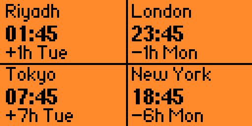
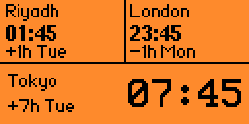

# FuseZero 🌍🕒

**A World Clock for Flipper Zero**

 

FuseZero is a Flipper Zero application that lets you view the local time in up to **four cities around the world**. It makes checking different time zones quick and convenient, directly from your Flipper Zero.

## Features

- **Up to 4 time zones:** Keep track of the time in up to four different cities.
- **World clock:** View local times across different regions of the world.
- **Time zone comparison:** Easily compare times between selected cities.
- **Flipper Zero interface:** Access your world clock directly from your device.
- **Lightweight application:** Designed for the Flipper Zero environment.

## Use Cases

FuseZero is useful for:

- ✈️ Travelers coordinating across different countries.
- 🌐 People working with international teams.
- 💬 Staying in touch with friends and family abroad.
- 🕒 Anyone who needs to monitor multiple time zones.

## Installation

1. Download or compile the FuseZero `.fap` application.
2. Copy the `.fap` file to your Flipper Zero's microSD card.
3. Open **Apps → Tools** on your Flipper Zero.
4. Launch **FuseZero**.

## Development

FuseZero is developed as an external application (FAP) for Flipper Zero.

- **Name:** FuseZero
- **Category:** Tools
- **Author:** Marcopiiit
- **Platform:** Flipper Zero
- **Purpose:** World clock with support for up to four cities

---

**FuseZero — Four cities. One device. Global time at a glance.**
